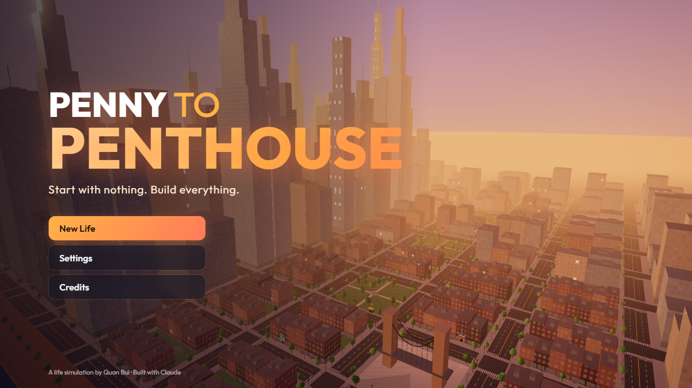
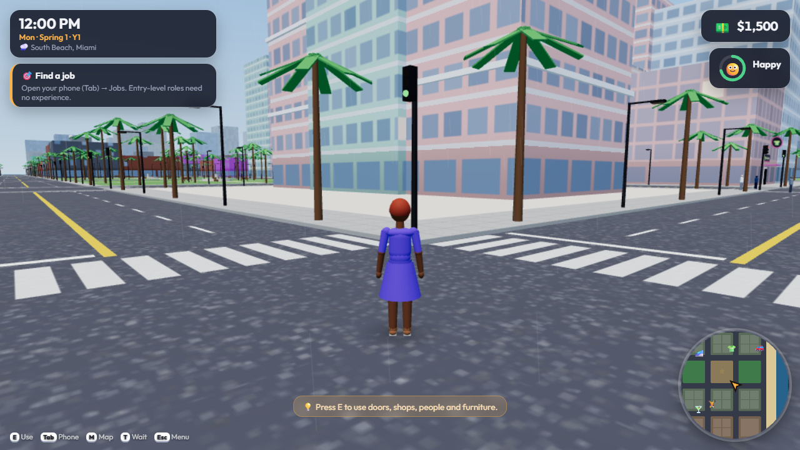

# PENNY TO PENTHOUSE

**Start with nothing. Build everything.**

Penny to Penthouse is a 3D third-person life simulation that runs in your browser. Pick a person and a US city, start broke in a rented room, then learn, work, make friends, invest, buy and design homes, and climb the city rankings all the way to a penthouse. Every dollar follows real personal-finance rules — paychecks, taxes, rent, credit scores, loans, index funds and mortgages — so getting rich takes actual decisions.

### ▶ Play online: https://dquanbui.github.io/penny-to-penthouse/




**Author:** Quan Bui — GitHub: [DQuanBui](https://github.com/DQuanBui) — dbui10@fordham.edu

## Features

- **Five open cities** — New York, Los Angeles, Chicago, Miami and Austin, each generated procedurally (12 × 12 blocks, about 860 m across; New York is 15 × 15 with six districts: Harlem, the Bronx, Midtown, Queens, Lower Manhattan and Brooklyn) with its own districts, skyline, landmarks, economy, weather and residents. Day/night cycle, seasons, rain (umbrellas out!), snow and heat haze.
- **Times Square** — glass towers wrapped in animated billboards for the game's fictional brands and Broadway shows, news tickers racing around them, a countdown ball, and red glass steps to sit on with the tourists.
- **Beaches** — Brighton Sands off the Brooklyn boardwalk (plus beaches in Miami and LA): sand that slopes into the sea, umbrellas, towels, a lifeguard tower, sunbathers, swimmers, volleyball and frisbee. Swim, sunbathe or join the volleyball game.
- **Street life that happens** — car crashes at the kerb (police and an ambulance respond; call 911, check on the driver) and purse snatchers you can chase down and catch for a reward. Food carts on corners all over the city: halal, hot dogs, pretzels, ice cream, coffee & bagels, fruit, churros & elote, dumplings. Ducks and swans on the harbor to feed.
- **Sports** — a fenced basketball court and five-a-side soccer pitch with pickup games you can join, and Borough Field ballpark in the Bronx.
- **A living street** — busy sidewalks of animated pedestrians who wait for the walk signal, step around obstacles, and now and then stop to shake hands and chat; dog walkers, pigeons that scatter, gulls and ducks; traffic that signals and takes smooth curved turns, and city buses that stop at shelters; parked cars, hydrants, bus shelters, food carts, buskers and people down on their luck you can help; parks with playgrounds and picnic tables; benches you can sit on.
- **People with jobs** — police officers, firefighters in turnout gear, paramedics, sanitation crews, construction workers in hi-vis, nurses, doctors, chefs, delivery riders, mail carriers, street vendors, business people, the wealthy, students, teachers, tourists, joggers, skaters, musicians, parents with strollers, older people with canes and people who are struggling, each dressed for the part. Actions menu (X): wave, cheer, dance for tips, jumping jacks, sit, phone calls and selfies.
- **Every street is open** — around 280 named neighbourhood businesses per city you can walk into, including Vietnamese pho, Korean BBQ, ramen, sushi, dumplings, tacos, Thai, Indian, halal, bubble tea, ice cream and wine bars, plus bars, nightclubs with dance floors, pizzerias, delis, diners, bakeries, pharmacies, barbers (change your hairstyle), nail spas, bookstores, laundromats, florists, cinemas and arcades, each with opening hours, staff, customers and a menu. Map filters for food, nightlife, shops, services and fun.
- **Zoo, museums, campus and school** — a big walled zoo beyond the city edge with eleven habitats (giraffes and zebras, elephants, lions, tigers, brown bears, hippos, rhinos, monkeys, kangaroos, penguins and a flamingo lagoon); art museums, natural history museums with a dinosaur skeleton, public libraries where you can study skills, and car showrooms; a university campus with a clock tower and a lecture hall; a public school with recess, where you can volunteer.
- **Fly between cities** — every city has an airport with planes landing and taking off. Fly to another city for a trip (stay at its grand hotel) and fly home whenever you like.
- **Every way to get around** — ten car body styles on the road (compacts, sedans, sport sedans, coupés, supercars, SUVs, pickups, box trucks, yellow cabs, police cruisers with flashing light bars) with drivers behind see-through glass; buy a supercar at the dealer; ride a CityCycle from a bike-share dock or your own bike (G); take the subway (walk down the stairwells from the sidewalk in New York; the elevated L in Chicago), buy a 7-day unlimited pass at the ticket machines, and ride the train between stations; or walk out onto the great suspension bridge and sit by the water.
- **Real-looking places (fictional brands)** — every café, bank, gym, dealer, mall and pet rescue has its own storefront: awnings, logo signs, glass lobbies, patios, mannequins and showroom cars. Interiors have city views that light up at night, curtains, wall clocks that keep game time and set tables.
- **Weekly city events** — farmers' markets, night markets, park concerts, art fairs, fun runs and street festivals on the Map and Calendar.
- **Adopt a dog** — choose a dog at the pet rescue; it heels beside you, waits outside shops, rides in your car, comes home with you and plays fetch. Walk it every day.
- **Photo mode** — hide the HUD, frame a shot and save it or post it: landmarks, events, your dog and golden hour earn more followers.
- **Character creator** — 10 backgrounds (Small-Town Dreamer to Rich Heir), 12 traits, body, face, 14 hairstyles, outfits and accessories with a live studio preview, plus a Random button.
- **Needs and mood** — Energy, Hunger, Hygiene, Fun, Social and Health shape how well you work and earn.
- **Careers** — 7 ladders (Tech, Finance, Healthcare, Creative, Trades, Hospitality, Real Estate) with interviews, shifts, promotions, raises and 7 mini-games. Side hustles any time.
- **Entrepreneurship** — start a food truck, café, app startup, clothing brand or property-management firm; hire, market, expand, sell — or go bust.
- **Deep personal finance** — checking and savings, budget and net-worth chart, progressive income tax, credit score and credit card, amortised loans, an investing app (index fund, 10 fictional stocks, bonds, crypto, market regimes and news), and real estate with mortgages, property tax, tenants and repairs.
- **Homes and build mode** — rent or buy from a room to a penthouse; place furniture on a grid, add walls, floors, paint and windows; style score lifts mood, popularity and parties.
- **People** — 160+ named residents with jobs, schedules and personalities. Chat, joke, hang out, date, find a roommate; friends bring referrals, discounts and party invites.
- **Popularity** — post from landmarks, go viral, land brand deals, throw house parties, unlock VIP tables.
- **Getting around** — walk, run, transit, taxis, or buy a car and drive it through traffic.
- **Goals, rankings and achievements** — life goals, 26 achievements, and city and national leaderboards against 100 AI rivals whose fortunes grow over time.
- **Life events** — 30 of them: job offers, market crashes, inheritances, jury duty, weddings, scams, heat waves, a stray dog and more, each with choices that matter.
- **The phone** — Bank, Invest, Homes, Jobs, Learn, Gigs, Ventures, Contacts, Pulse, News, Goals, Rankings, Calendar, Map and Settings.
- **Saves** — 3 slots, autosave, export/import as a JSON file, and a Hall of Fame across lives.
- **Everything is procedural** — no downloaded art or audio: the city, characters, furniture, textures, sound effects and music are generated at runtime.

## Controls

| Key | Action |
| --- | --- |
| W A S D | Move |
| Shift | Run |
| Space | Jump |
| Mouse drag (or pointer lock — see Settings) | Orbit the camera |
| Mouse wheel | Zoom |
| E | Interact: doors, people, shops, beds, computers, work stations |
| Tab or P | Phone |
| M | Map (set a GPS waypoint, call a taxi) |
| B | Build mode (inside your home) |
| T | Wait / skip time |
| H | Photo mode |
| G | Get on / off your bike |
| X | Actions: wave, cheer, dance, jumping jacks, sit, phone, selfie |
| W / S, A / D (on a bike) | Pedal / brake, steer |
| F | Get in / out of your car |
| W / S, A / D (in a car) | Throttle / brake, steer |
| Esc | Pause, or close the current screen |

The optional "First Day" tutorial walks you through the first few minutes.

## Run it locally

1. Install [Node.js LTS](https://nodejs.org/).
2. In this folder:

```bash
npm install
npm run dev
```

3. Open the address Vite prints (usually http://localhost:5173).

Other commands:

| Command | What it does |
| --- | --- |
| `npm run build` | Production build into `dist/` |
| `npm run preview` | Serve the production build locally |
| `npm run sim` | Headless balance check: plays 7 strategies for 5 in-game years and prints net worth (`npm run sim 8 newyork` for 8 years in New York) |
| `npm run smoke <scenario>` | Automated browser test with screenshots (needs `npm run dev` running and Edge or Chrome installed) |

In development builds, **F1** opens a debug panel (money, time, skills, teleport, events).

## Adding free character models

The game looks complete without any downloads, but you can drop in free CC0 character, vehicle and furniture models or your own audio. See **[ASSETS.md](ASSETS.md)** for exactly which packs to get and where to put the files.

## Project layout

```
src/core        game loop, input, saves, settings, post-processing
src/world       city generator, buildings, roads, sky, weather, interiors, vehicles, traffic
src/characters  procedural humanoids, animation, player controller, NPCs, crowd
src/sim         the headless simulation: needs, jobs, finance, market, real estate, social...
src/build       build mode and furniture meshes
src/minigames   one file per career mini-game
src/ui          HUD, phone apps, menus, creator, map
src/audio       procedural sound effects, ambience and music
src/data        ALL content: cities, careers, courses, items, furniture, NPCs, events, balance
```

All game content is data-driven: add a city, career, course, item or event by editing `src/data/` — no engine changes. Every tuning number lives in `src/data/balance.js`.

## Deployment

Pushing to `main` builds and publishes to GitHub Pages through `.github/workflows/deploy.yml` (repository **Settings → Pages → Source** must be **GitHub Actions**).

## Credits

- Design and development: **Quan Bui**
- Engine: [Three.js](https://threejs.org/) and [Vite](https://vitejs.dev/)
- All cities and neighbourhoods are real places; every business, brand and person in the game is fictional.

Built with Claude (Fable 5.2) in VS Code.
